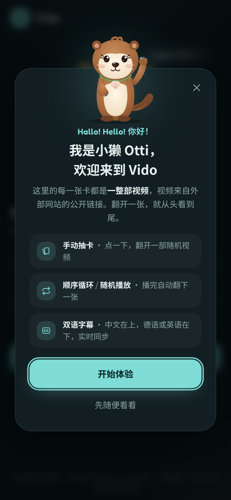
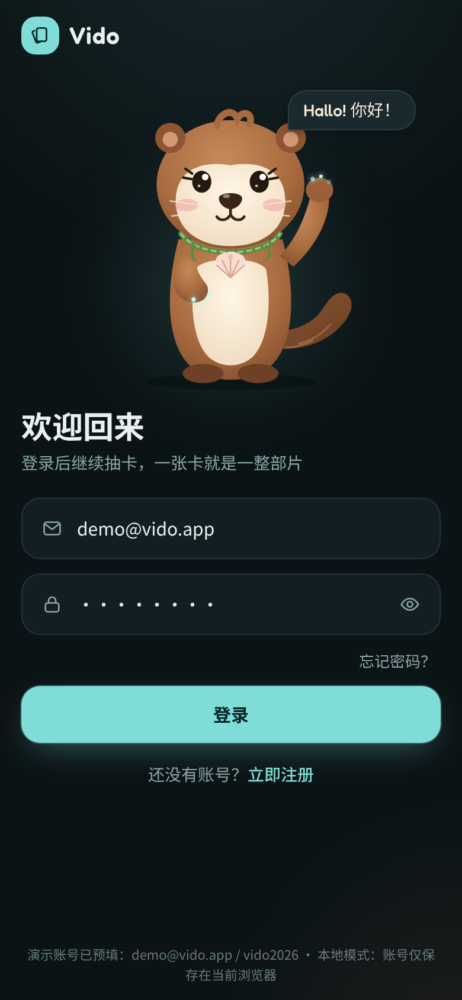
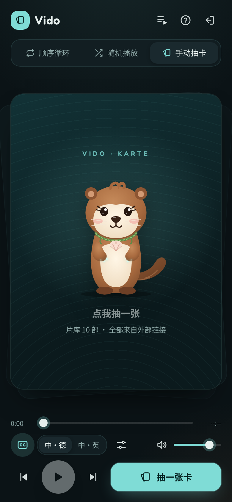
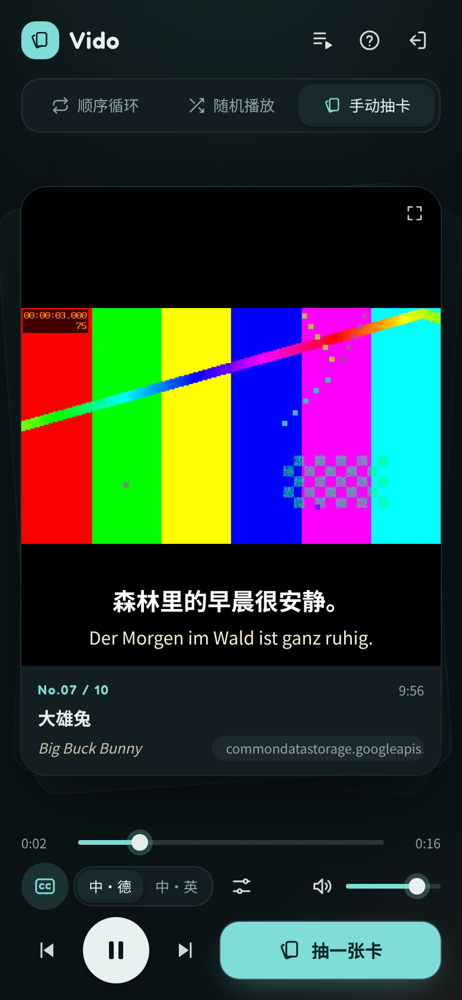
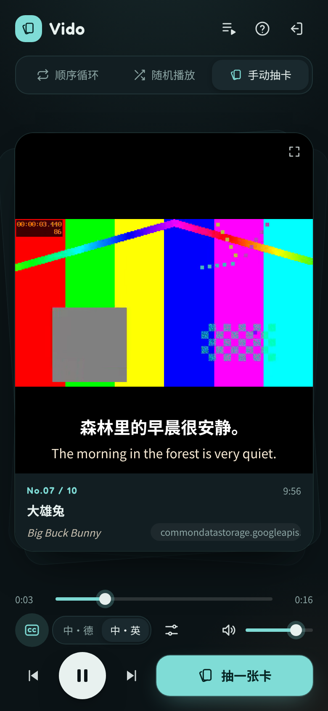
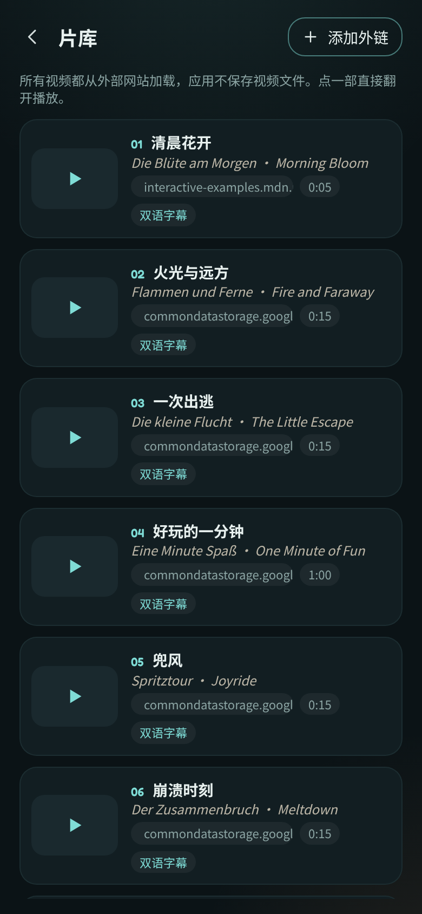

# Vido · 抽卡看片

抽一张卡，看一整部片。Vido 是一个移动端优先的网页 App：每张卡牌对应一条**完整视频**，视频来自**外部网站的公开链接**，另有两部随网站一起托管的「站内」短片，保证在任何网络下都能先看到画面、听到声音，播放时**中文字幕在上、德语或英语字幕在下**，随画面实时同步。

在线体验：<https://717986230.github.io/rj-yy/>（GitHub Pages：推送到 `main` 后由 Actions 构建并发布到 `gh-pages` 分支）

| 首次启动欢迎卡 | 登录 | 卡牌背面 | 中·德字幕 | 中·英字幕 | 片库 |
| --- | --- | --- | --- | --- | --- |
|  |  |  |  |  |  |

> 截图中的彩条画面是测试环境用的替身视频（构建环境的网络无法访问外部视频站），线上访问时播放的是真实外链视频。

## 功能

- **账号**：邮箱 + 密码登录、注册、忘记密码 / 重置密码。
- **首次启动欢迎弹窗**：第一次打开 App 自动弹出，水獭吉祥物 Otti 打招呼并介绍玩法，可开始或关闭。
- **卡牌抽选**：点击抽卡 → 洗牌 → 3D 翻牌 → 加载外链视频并播放。每张卡是一整条视频，不是句子。
- **三种播放模式**
  - 顺序循环：播完自动翻开下一张，最后一张之后回到第一张
  - 随机播放：洗牌袋算法，一轮内不重复
  - 手动抽卡：每部播完停下，由你抽下一张
- **双语字幕实时同步**：中文固定在上；第二语言可在「中·德」「中·英」之间随时切换。播放时按视频帧（`requestVideoFrameCallback`）取时间，拖动进度、暂停时同样即时刷新；支持 ±0.5 秒字幕时间微调。
- **左右滑动切换**：在卡片上左滑看下一部，右滑回上一部，卡片跟手滑出再翻开新的一张。
- **播放诊断**：点左上角 Vido（下方显示版本号）打开诊断面板，实时显示浏览器、视频加载状态、解码帧数等，方便截图反馈。
- **播放器控制**：播放 / 暂停、上一部 / 下一部、进度拖动、音量与静音、字幕开关、全屏；键盘快捷键 空格 / ← → / N / D / C。
- **片库**：浏览全部视频；粘贴任意 http(s) 视频直链添加自己的视频，可粘贴或上传中 / 德 / 英三种 WebVTT 或 SRT 字幕。
- **外链容错**：多线路自动切换，失败时说明原因并可重试 / 换一张；片库可一键检测哪些外链在当前网络下能播；点击抽卡时即解锁手机浏览器的声音；若仍被拦截，先静音播放并在画面中央显示「点击开启声音」。

## 项目结构

```
.
├── apps/
│   ├── web/                 # 前端：Vite + Tailwind CSS + TypeScript，部署到 GitHub Pages
│   │   └── src/
│   │       ├── app/         # 路由、状态、存储、DOM 工具
│   │       ├── services/    # api（本地 / HTTP 两种实现）、player（视频引擎）
│   │       ├── components/  # 吉祥物、欢迎弹窗、字幕层、表单、图标、弹层
│   │       └── pages/       # 登录 / 注册 / 找回密码、播放页、片库
│   └── server/              # 后端：Express + SQLite + JWT，可选部署
├── packages/shared/         # 前后端共用：类型、API 契约、字幕解析、播放队列、示例片库
├── docs/ARCHITECTURE.md     # 架构说明
└── .github/workflows/       # CI 与 Pages 自动部署
```

详细设计见 [docs/ARCHITECTURE.md](docs/ARCHITECTURE.md)。

## 本地开发

需要 Node.js 20+。

```bash
npm install
npm run dev          # 前端 http://localhost:5173 （本地存储模式，演示账号 demo@vido.app / vido2026）
npm run check        # 类型检查 + 全部测试
npm run build        # 构建前端到 apps/web/dist
```

### 连接后端（可选）

GitHub Pages 只能托管静态文件，所以前端默认使用浏览器本地存储完成账号与片库功能。需要多设备同步账号时，启动后端并让前端指向它：

```bash
cp apps/server/.env.example apps/server/.env   # 修改 JWT_SECRET、CORS_ORIGIN
npm run dev:server                             # http://localhost:8787/api
VITE_API_BASE=http://localhost:8787/api npm run dev
```

线上部署：把 `apps/server` 用附带的 `Dockerfile` 部署到任意支持 Node 的平台（Render、Railway、Fly.io、自有服务器等），然后在仓库 **Settings → Secrets and variables → Actions → Variables** 新建 `VITE_API_BASE`（例如 `https://api.example.com/api`），再次推送即可让 Pages 上的前端改用后端。

## 后端接口

| 方法 | 路径 | 说明 |
| --- | --- | --- |
| POST | `/api/auth/register` | 注册，返回 `{ token, user }` |
| POST | `/api/auth/login` | 登录 |
| POST | `/api/auth/forgot` | 申请重置密码（开发环境直接返回 `devToken`） |
| POST | `/api/auth/reset` | 用令牌设置新密码，令牌一次有效、30 分钟过期 |
| GET | `/api/auth/me` | 当前用户 |
| GET | `/api/videos` | 片库列表（内置 + 自己添加的） |
| GET | `/api/videos/:id` | 单条视频，含中 / 德 / 英字幕 |
| GET | `/api/videos/:id/subtitles/:lang.vtt` | 导出单语 WebVTT（`zh` / `de` / `en`） |
| POST | `/api/videos` | 添加外链视频与字幕 |
| DELETE | `/api/videos/:id` | 删除自己添加的视频 |

## 视频与字幕来源

**哔哩哔哩剧集（DW 德语课、德语动画）**：片库优先收录 B 站上标明「中德字幕」的视频，例如 DW 的 *Nicos Weg*、《布鲁伊》《小猪佩奇》德语版、《疯狂动物城》德语版、《小王子》德语广播剧。它们用 B 站官方嵌入播放器播放，Vido 不下载、不转存视频。中德字幕是视频画面自带的，所以这类卡片上 Vido 自己的字幕层、进度条和音量设置不起作用，要用 B 站播放器自己的控件。在片库里粘贴 B 站地址（`https://www.bilibili.com/video/BV…/?p=N`）就能添加，一个多 P 视频可以按集数范围一次加入多集，片库按剧集分组显示。b23.tv 短链接需要先在浏览器打开，再复制完整地址。


内置片库前两部是「Vido 站内」短片（`apps/web/public/media/`，同时经 jsDelivr 提供备用线路）：Otti 开场片（本项目自制）和《Big Buck Bunny》片段（© Blender Foundation，CC BY 3.0）。两部都配了德语旁白，用 Piper 离线语音合成的 Thorsten 德语声音（CC0）生成，字幕时间轴按旁白逐句对齐。第一次抽卡固定翻开 Otti 开场片。

其余是第三方公开外链，排在前面的是中国大陆网络通常能直接访问的来源（字节跳动火山引擎 CDN 上的西瓜播放器示例视频、video.js CDN、w3school 中文站），后面是 W3C、Google 示例视频桶（含 Blender 开放电影）与 MDN 的素材，这些在部分网络下可能打不开。

- 每条视频可以带多条备用链接，主链接打不开或 12 秒内没有画面时自动切换下一条；全部失败时列出每条线路的失败原因，自动模式下 4 秒后跳到下一张。
- 片库页的「检测外链」会在你当前的网络下逐条试探，标出「可播放 / 打不开」。
- 本站是 https，浏览器会拦截 http 视频链接，添加视频时请使用 https。

内置字幕是演示用的中 / 德 / 英三语示例句，并非影片原台词；你可以在片库里为自己的视频导入真实字幕文件。
