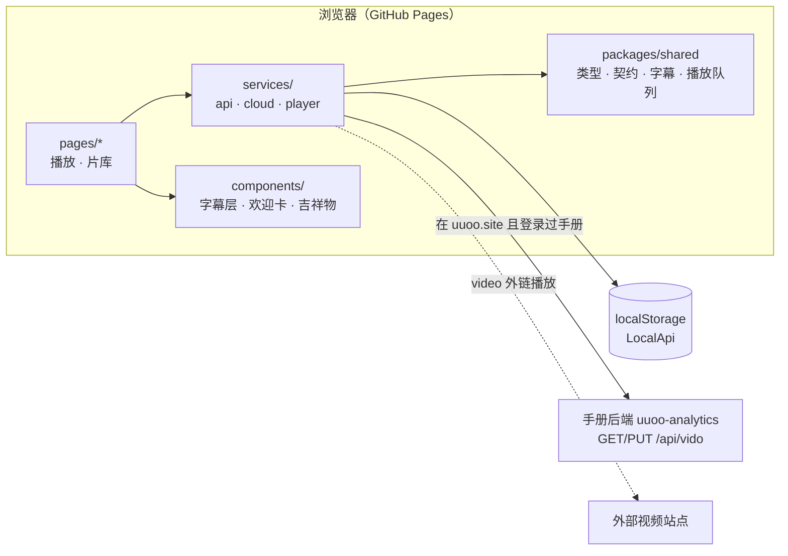

# Vido 架构说明

## 总览

三层：

1. **packages/shared**：共用的纯 TypeScript 代码，不依赖 DOM 或 Node。
   - `types.ts`：`Video`、`SubtitleTracks`、`PlayMode`，以及前后端唯一契约 `ApiClient`。
   - `subtitles.ts`：WebVTT / SRT 解析、二分查找当前字幕、按时间取「中文 + 第二语言」。
   - `playlist.ts`：三种播放模式的队列逻辑（顺序循环、洗牌袋随机、手动抽卡）与历史回退。
   - `seed.ts`：内置外链片库与三语示例字幕。
2. **apps/web**：无框架的 TypeScript + Tailwind 前端，按 `app / services / components / pages` 分层。

## 数据存在哪里

Vido 没有自己的后端，也不用登录。`apps/web/src/services/api/index.ts` 只有 `LocalApi`：
打开时自动进入一个本机账号，片库、自己加的视频、隐藏的卡片都在 localStorage。

在 www.uuoo.site/vido/ 打开、且同域 localStorage 里有手册的 `acct_token` 时，
`services/cloud.ts` 把「隐藏的卡片 + 自己加的视频」同步到手册后端的 `/api/vido`（带 rev，冲突 409 后合并重试）：

- 本机第一次和这个手册账号同步：本机与云端取并集；
- 之后：启动时以云端为准整份照搬（别的设备上的取消隐藏、删除也能带过来），本地一改就推上去。

任何失败（未登录、过期、接口还没部署）都静默退回纯本地。

## 播放与字幕同步

`services/player.ts` 中的 `VideoEngine` 封装 `<video>`：

- 加载外链、播放 / 暂停、跳转、音量；有声自动播放被拦截时自动静音重试。
- **时钟**：播放时用 `requestVideoFrameCallback` 获取每一帧对应的 `mediaTime`（帧级精度），不支持的浏览器退回 `requestAnimationFrame` 读取 `currentTime`；暂停、拖动时由 `seeked` / `timeupdate` 补发。
- 每次时钟触发，`SubtitleOverlay` 用二分查找分别取中文轨和所选第二语言轨的当前句，仅在文字变化时更新 DOM。

中文与德语 / 英语是**独立的字幕轨**，各自有时间轴，因此可以导入时间轴不同的字幕文件；切换「中·德 / 中·英」只换下方那一轨，立即生效。

## 卡牌翻转

`.card` 使用 CSS 3D（`preserve-3d` + `backface-visibility`）。抽卡流程：

1. 如已翻开，先翻回背面（0.64s）；
2. 卡堆洗牌动画（0.46s），同时并行请求视频详情；
3. 填充正面信息并翻到正面，翻转过半时开始加载并播放外链。

## 路由

Hash 路由（`#/play`、`#/library`），GitHub Pages 无需服务端重写，刷新与分享链接都可用；其他地址都回到播放页。

## 测试

| 范围 | 文件 |
| --- | --- |
| 字幕解析、时间查找、双语对齐 | `packages/shared/test/subtitles.test.ts` |
| 三种播放模式、历史回退、示例片库校验 | `packages/shared/test/playlist.test.ts` |
| 本地模式账号与片库 | `apps/web/test/local-api.test.ts` |
| 字幕层渲染、语言切换、偏移 | `apps/web/test/subtitle-overlay.test.ts` |
| 同步到手册账号 | `apps/web/test/cloud.test.ts` |

`npm run check` 运行类型检查与全部测试；CI 在每次推送和 PR 上执行。
